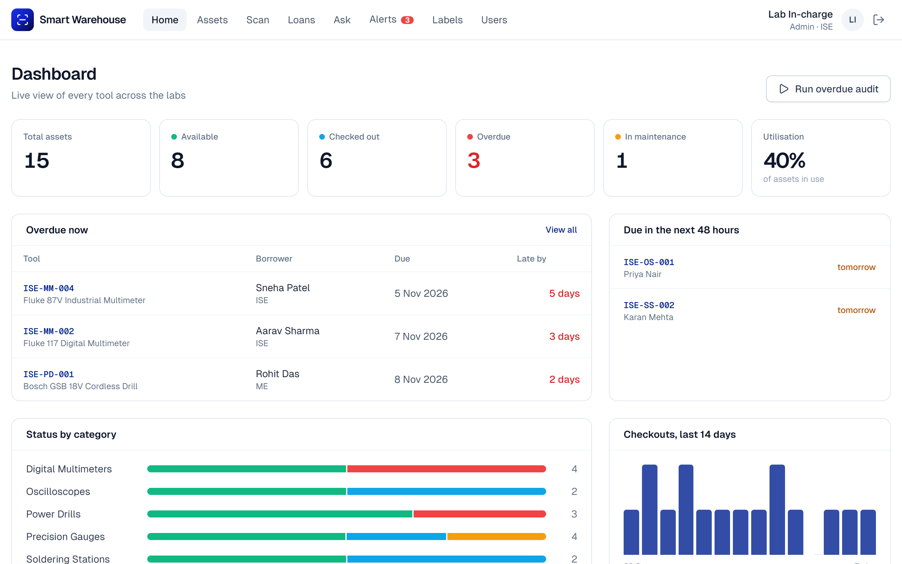
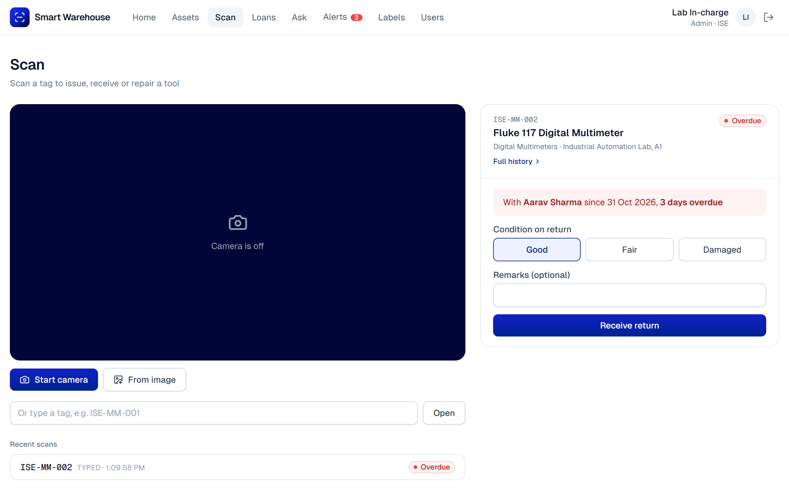
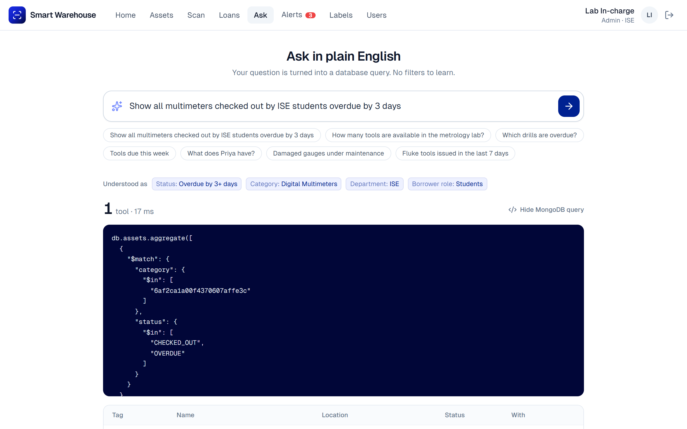
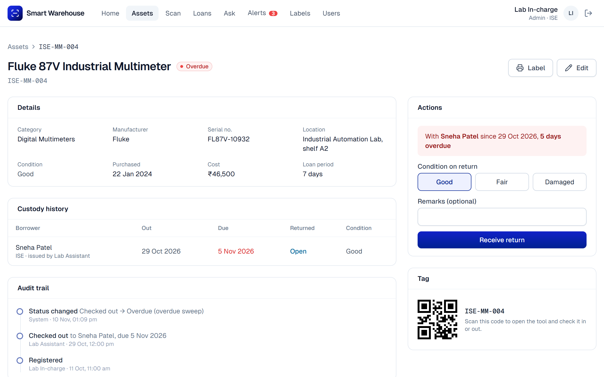

# Smart Warehouse Tool and Asset Tracker

A mobile-first web app for tracking shared lab and workshop tools. Each tool gets a QR code and Code 128 barcode that can be scanned with any phone or laptop camera. The app keeps a full chain of custody (who has which tool, since when, and when it is due), flags overdue loans automatically, and lets staff search the inventory in plain English.

B.Tech Project (BTP-I), Department of Industrial and Systems Engineering, IIT Kharagpur, Autumn 2026-27.
Shani Maurya (23IM30043), supervised by Prof. J. K. Jha.

## Features

- **Tagging and scanning**: tags in the form `DEPT-CAT-NNN` (e.g. `ISE-MM-004`), printable QR and Code 128 labels, and an in-browser scanner. Tags can also be read from a photo or typed.
- **Chain of custody**: check out, return, send to maintenance and mark repaired. Atomic conditional updates and a partial unique index ensure a tool can never have two open loans, even with simultaneous requests. Every change is recorded in an audit log.
- **Overdue audit and alerts**: an hourly job flags past-due loans and emails each borrower once. Damaged returns go to maintenance and alert lab staff. Without SMTP settings, emails are kept in preview mode and shown on the Alerts page.
- **Plain-English search**: questions like "show all multimeters checked out by ISE students overdue by 3 days" are turned into MongoDB queries. It runs locally with no external AI service and tolerates typos.
- **Dashboard**: live counts, utilisation, overdue and due-soon loans, status by category and recent activity.
- **Roles**: Admin, Lab staff and Borrower, with JWT session cookies and bcrypt-hashed passwords.

## Screenshots

| Dashboard | Scan and return |
| --- | --- |
|  |  |

| Plain-English search | Asset history |
| --- | --- |
|  |  |

## Tech stack

- Next.js 14 (App Router, Server Actions), React 18, TypeScript
- Tailwind CSS
- MongoDB with Mongoose, Zod
- html5-qrcode (ZXing), qrcode.react, JsBarcode
- jose, bcryptjs
- node-cron, Nodemailer

## Getting started

Requirements: Node.js 20.19 or newer, and MongoDB (local or MongoDB Atlas).

```bash
git clone https://github.com/shani8828/smartWarehouseToolandAssetTracker.git
cd smartWarehouseToolandAssetTracker
npm install
cp .env.example .env.local
npm run seed
npm run dev
```

Open http://localhost:3000. `npm run seed` clears the database and loads demo data.

### Environment variables

| Variable | Description |
| --- | --- |
| `MONGODB_URI` | MongoDB connection string |
| `SESSION_SECRET` | Long random string used to sign sessions |
| `CRON_SECRET` | Secret for the `/api/cron/overdue` endpoint |
| `APP_URL` | Public URL of the app |
| `SMTP_HOST`, `SMTP_PORT`, `SMTP_USER`, `SMTP_PASS`, `MAIL_FROM` | Optional email settings. Leave `SMTP_HOST` empty for preview mode |

### Demo accounts

Created by `npm run seed`:

| Role | Email | Password |
| --- | --- | --- |
| Admin | admin.iselab@example.com | admin123 |
| Lab staff | staff.iselab@example.com | staff123 |
| Borrower | priya.n@example.com | student123 |

Camera scanning needs `localhost` or HTTPS. To test on a phone locally, use an HTTPS tunnel such as `ngrok http 3000`.

## Scripts

| Command | Description |
| --- | --- |
| `npm run dev` | Start the development server |
| `npm run build` / `npm start` | Production build and server |
| `npm run seed` | Reset and seed the database |
| `npm run lint` / `npm run typecheck` | Lint and type-check |
| `npx tsx --require ./scripts/allow-server-only.cjs scripts/functional-test.ts` | Custody engine tests |
| `npx tsx scripts/nlq-eval.ts --heldout` | Search parser evaluation |
| `npx tsx --require ./scripts/allow-server-only.cjs scripts/bench.ts 100 1000 10000` | Performance benchmark |

The test and benchmark scripts use separate databases and do not touch the demo data.

## Deployment

The app can be deployed on Vercel with a MongoDB Atlas database:

1. Create an Atlas cluster and allow access from `0.0.0.0/0`.
2. Seed it once: `MONGODB_URI="<atlas-uri>" npm run seed`.
3. Import the repository in Vercel and add the environment variables above.

`vercel.json` runs the overdue audit every hour through Vercel Cron. On the Hobby plan cron jobs can only run once a day, so change the schedule (e.g. `0 9 * * *`) if needed. The audit can also be run manually from the Alerts page.

## Project structure

```
scripts/          seed data, tests and benchmarks
src/app/          pages, Server Actions and API routes
src/components/   UI components
src/lib/          custody engine, overdue audit, search parser, queries
src/models/       Mongoose models
```
